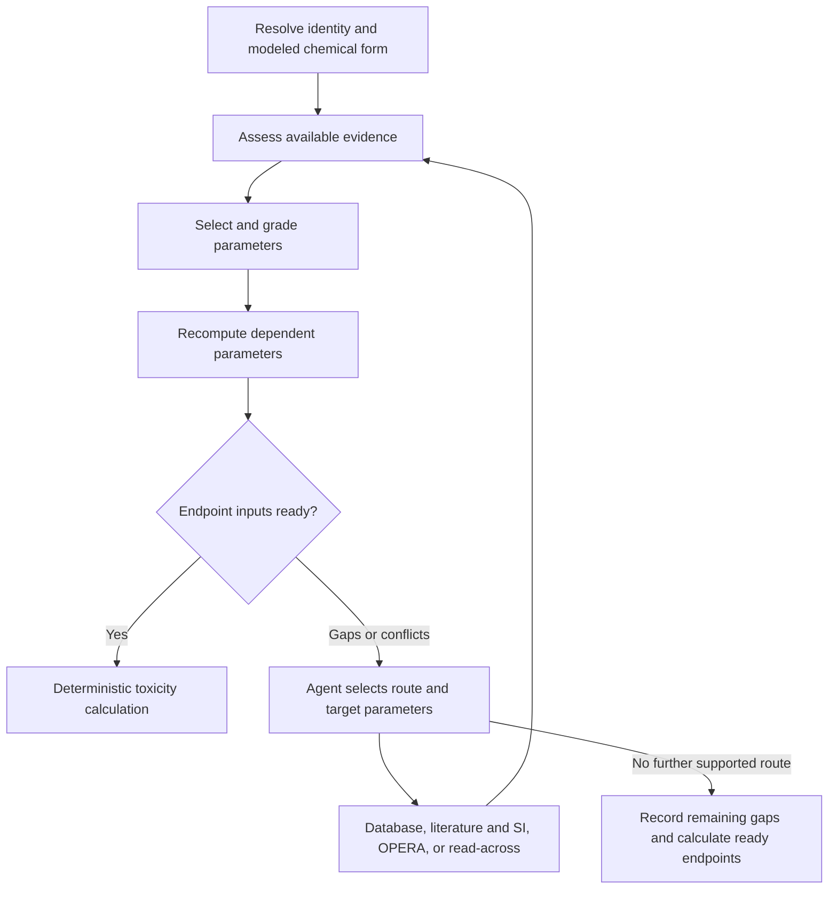

# Agent-guided PFAS toxicity characterization

The agent prepares substance-specific inputs by interpreting evidence, identifying unresolved parameters and deciding which acquisition step to take next. It combines language-model assessment with deterministic identity, unit, domain and provenance checks.

`agent_core.py` is a compact implementation of this control loop. `parameter_contract.py` carries the study model's 25 canonical parameter definitions and endpoint dependencies. The full application's service integrations are represented by the `Services` interface.

[`decision_prompt.md`](decision_prompt.md) gives the structured assessment and next-action contracts used at the language-model interface.

## Evidence and decision cycle

The feedback is explicit in `run()`: each acquisition changes the evidence state; reassessment changes the selected parameters and gaps; the next action is chosen from the remaining routes. `Services.decide()` receives the evidence, conflicts, selection history and per-parameter route availability. It returns a route, target parameters and a reason. A follow-up can revisit literature for a specific unresolved parameter instead of restarting the whole search.

## Evidence selection

| Tier | Evidence | Role |
|---|---|---|
| T1 | Reviewed direct evidence | Substance-specific observations |
| T2 | Deterministic derivation | Values derived from accepted inputs using defined relationships |
| T3 | Prediction | Applicable model predictions, including OPERA |
| T4 | Read-across or assumption | Parameters supplied through the assessed fallback route |

Candidates retain chemical identity, modeled form, value, canonical unit, source and exact locator. The assessment adapter interprets evidence and resolves conflicting meanings. The controller validates numerical and identity constraints, prioritizes evidence routes, removes repeated measurement groups and aggregates eligible independent values using the availability-first arithmetic-mean policy. Every selection and follow-up action is retained in the returned audit record.

## Service interfaces

| Interface | Connected operation |
|---|---|
| `resolve(query)` | Registry and structure-based identity resolution; parent-acid normalization |
| `retrieve(identity, action)` | Targeted acquisition from a snapshot, CTX, literature/SI, OPERA or read-across |
| `assess(identity, evidence)` | Structured language-model interpretation and scientific evidence assessment; returns accepted IDs, unresolved conflicts and reasons |
| `decide(state, available)` | Select the next route and parameter targets from intermediate findings |
| `derive(identity, selected)` | Recompute fixed derivations such as dissolved-organic-carbon partitioning from selected organic-carbon partitioning |
| `calculate(identity, endpoint, parameters)` | Deterministic PFAS-adapted USEtox calculation |

Provider adapters return `Evidence` records after extracting and converting values into canonical units. Read-across records identify the target chemical and retain donor/source details in their provenance and rationale. Derived records use stable, distinct IDs encoding their parent evidence; the controller rebuilds these candidates after each acquisition cycle.

The compact controller illustrates control decisions through per-parameter route-call budgets. The full study workflow additionally manages document-level search and reading budgets inside the provider services. Registry/API clients, browser access, local OPERA deployment, database storage and the desktop supervisor remain in the full application.

## Endpoint-specific calculation

The parameter contract contains 19 fate/exposure fields and six effect fields, including the historical marine effect field. Public workflow endpoints are human cancer toxicity, human non-cancer toxicity and freshwater ecotoxicity. The controller assesses each endpoint's dependencies independently, so missing human-effect data do not prevent a ready freshwater calculation.

The deterministic calculator resolves fate and exposure and combines them with the relevant effect factor. The overall characterization relationship is `CF = FF × XF × EF`; implementation accounts for emission compartments and individual exposure pathways.

The agent returns selected parameters, evidence records, endpoint results and the decision audit. Human oversight acts through review of the evidence assessments and selected parameter set. The approved characterization factors then enter the main model through `Data input/toxicity/PFAS_toxicity_input.xlsx`.
