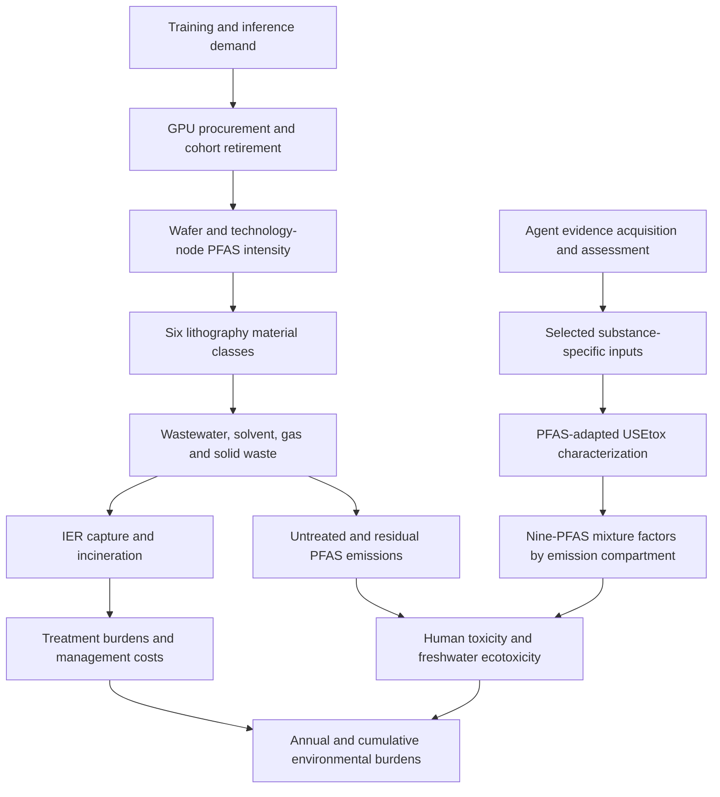

# PFAS lithography model 2.0

This repository presents the computational framework linking generative-AI computing demand to PFAS use, emissions, toxicity and waste-management burdens in semiconductor photolithography. Version 2.0 introduces wafer-based manufacturing attribution, explicit treatment and residual-emission accounting, and an agent-guided workflow for substance-specific toxicity parameters.

The code is organized for reading the study's calculation chain. It contains the main model implementation and a compact agent controller. Input Excel workbooks and numerical result datasets will be added separately.

## Model workflow



Training and inference demand determine new GPU-equivalent purchases after accounting for surviving computing capacity and cohort retirement. Quarterly manufacturing is multiplied by node-specific PFAS intensity, then distributed across six material classes and four waste streams. Treatment calculations track captured PFAS, resin requirements, incineration burdens and residual parent PFAS. Substance-specific characterization factors connect these emissions to human non-cancer toxicity and freshwater ecotoxicity.

## Repository structure

| Directory | Contents |
|---|---|
| `Core code example/` | Main entry point and calculation modules for demand, manufacturing, treatment, toxicity, economics and uncertainty |
| `Agent workflow/` | Compact evidence-assessment and decision controller, canonical parameter definitions and service interfaces |
| `Data input/` | Input-workbook map and expected table structure |
| `Economic model/` | Work-breakdown-structure cost interface and workbook map |
| `Excel results/` | Output map; the historical directory name is retained, while this code edition writes JSON and NumPy result files |
| `Data for figures/` | Connections between model outputs and manuscript figures |
| `Premise-IAM/` | Connection between scenario-specific background inventories and treatment calculations |
| `docs/` | Calculation guide, version changes and source map |

## Read the code

1. Start with [`Core code example/main.py`](Core%20code%20example/main.py) for the sequence of model calls.
2. Follow [`docs/MODEL_GUIDE.md`](docs/MODEL_GUIDE.md) for module inputs, calculations and outputs.
3. Read [`Agent workflow/README.md`](Agent%20workflow/README.md) and [`agent_core.py`](Agent%20workflow/agent_core.py) for the evidence-to-decision loop.
4. Use [`Data input/README.md`](Data%20input/README.md) to connect workbook inputs to the model.

## Running the main model

Python 3.10 or later is required. Install the main-model dependencies:

```bash
python -m pip install -r requirements.txt
python "Core code example/PFAS usage-burden prediction.py" --help
```

After placing the study workbooks at the locations listed in `Data input/README.md` and `Economic model/README.md`, run a scenario from the repository root:

```bash
python "Core code example/PFAS usage-burden prediction.py" \
  --scenario aggressive --current-scenario-only \
  --results-root "Excel results/aggressive"
```

The same entry accepts `moderate` and `conservative`. Each scenario uses the shared calculation modules. Inputs control Monte Carlo sample size, random seed, composition and treatment assumptions. Output paths are relative to this repository; a custom result directory can be supplied with `--results-root`.

The agent controller uses Python's standard library. Its service interfaces connect chemical identity resolution, database and literature acquisition, structured language-model assessment, prediction, read-across and deterministic toxicity calculation. The module README describes each connection.

## Agent and model integration

The agent evaluates parameter evidence and chooses targeted follow-up actions. It records the selected value, evidence tier, source location and selection rationale. Ready endpoint-specific parameter sets are passed to the PFAS-adapted USEtox calculation. Resulting characterization factors are assembled into `PFAS_toxicity_input.xlsx`, which supplies the main model's mixture calculation.

This separates evidence acquisition from scenario evaluation: the main model uses a fixed, traceable parameter set across scenarios, while the agent workflow updates the substance-level evidence supporting that set.

## Version 2.0

The previous repository used a server–emission–burden pipeline and PFOA/PFOS-based toxicity calculations. This version expands the model to quarterly manufacturing attribution, nine-substance mixture toxicity, explicit capture and destruction pathways, shared-path Monte Carlo propagation and agent-guided parameter preparation. See [`docs/CHANGES.md`](docs/CHANGES.md) for the module mapping.

Code is distributed under the [MIT License](LICENSE).
